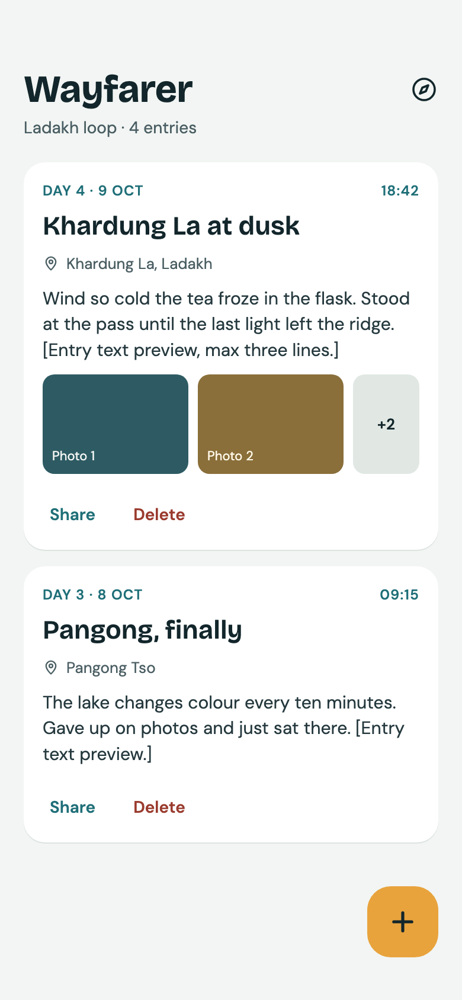
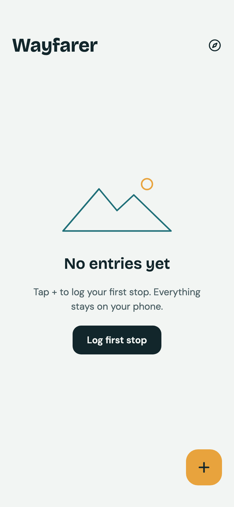
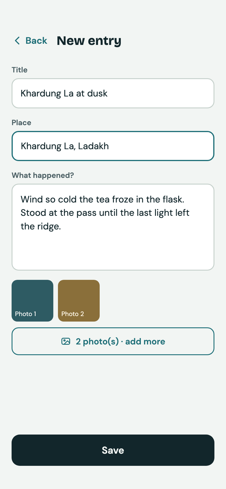
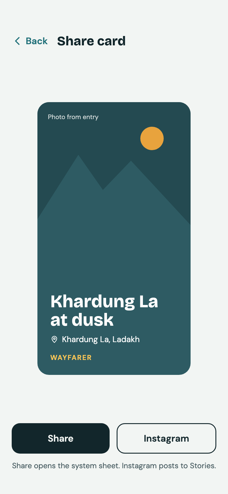

# Wayfarer mockups

The first design pass for the app: four phone screens, drawn on a Claude Design canvas
(<https://claude.ai/artifact/JpgWjEjuXze5GQQiZKwQSs>, private to the owner). The running app follows these
colours and type; it has since gained things the mockups do not show (see "Not in the mockups").

| Screen | Preview |
|--------|---------|
| Timeline |  |
| Timeline, empty |  |
| New entry |  |
| Share card |  |

## Folders
- `preview/` standalone `.html` plus 2x `.png` of each screen. Open the `.html` in any browser (it loads the two fonts from Google Fonts).
- `canvas/` the source files exactly as stored on the canvas (`*.dc.html` + `canvas.json`). They rely on the canvas runtime (`support.js`), so they only render inside the Design canvas; use them to re-import or to diff against the canvas.
- `build_previews.py` regenerates `preview/` from `canvas/` (needs Chrome): `python3 design/mockups/build_previews.py`.

## Design tokens
| Token | Value |
|-------|-------|
| Ground | `#F2F5F3` |
| Ink | `#12262B` |
| Ink soft | `#4A5E63` |
| Teal | `#1F6F78` |
| Amber | `#E8A33D` |
| Danger | `#9A3B2E` |
| Outline | `#C5D0CB` |
| Headings | Bricolage Grotesque 600/700 |
| Body | DM Sans 400/500/600 |

The same values live in code in `shared/.../presentation/Theme.kt` (`WfColors`).

## Not in the mockups
Edit button on cards, photo thumbnails with a circled-cross to remove them, keyboard dismissal, the swipeable photo pager with dots on the share card, and the app icon (`design/icon/`). Photo placeholders and sample text here (Ladakh entries) are invented.
